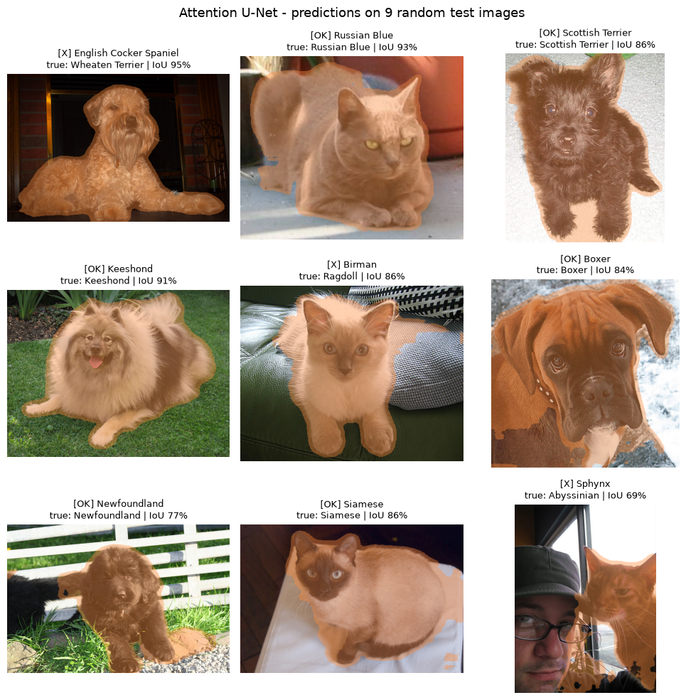

# Pet Segmentation & Breed Classification with U-Net

A single network that does two jobs at once: it **outlines the pet in a photo** (pixel-level segmentation) and **names its breed** (one of 37 cat and dog breeds). We built a multi-task U-Net from scratch in PyTorch, then tested whether adding attention gates makes it better.

> **Group project.** Built as a team for a university Image Processing course.



*Orange is the predicted pet mask. Titles show predicted breed, true breed, and how much the predicted mask overlaps the true one (IoU).*

## Results

On a held-out test set of 1,103 images:

| | U-Net | Attention U-Net |
|---|---|---|
| **Segmentation:** mean IoU | 0.882 | 0.882 |
| **Segmentation:** Dice score | 0.917 | 0.918 |
| **Segmentation:** pixel accuracy | 93.9% | 93.8% |
| **Breed accuracy** (37 classes) | 70.6% | 69.9% |
| **Cat vs. dog accuracy** | 94.7% | 95.2% |

What we learned:

- **Segmentation works well.** Both models outline the pet with about 0.92 Dice.
- **Attention gates made no measurable difference.** The gap between the two models is within run-to-run noise. Their benefit showed up as slightly cleaner masks on cluttered backgrounds, not as higher overall scores.
- **The breed classifier overfits.** It hits 94% on training data but 70% on test data. Telling 37 breeds apart from about 5,000 images, without a pretrained encoder, is the hard part of this task.

## How we did it

1. **Data.** Used the Oxford-IIIT Pet dataset: 7,349 labelled images across 37 breeds (12 cat, 25 dog). Each image has a trimap mask (pet, background, border), which we converted to a binary pet/background mask. Split 70/15/15 into 5,144 train, 1,102 validation and 1,103 test images.
2. **Preprocessing.** Resized to 128×128 and normalised with ImageNet statistics. Masks were resized with nearest-neighbour interpolation so they stay binary. Images were cached in RAM to speed up training.
3. **Augmentation** with Albumentations: horizontal flips, small shifts, scaling and rotations, and brightness/contrast changes.
4. **Model.** A 4-level U-Net (about 10.4M parameters). The decoder produces the pet mask. A classification head attached to the bottleneck predicts the breed. Both are trained together.
5. **Joint loss:** 0.5 × BCE + 0.5 × Dice for the mask, plus 0.5 × cross-entropy for the breed.
6. **Tuning.** A grid search over 4 optimisers and 4 learning rates on a 1,500-image subset. Final models were trained for 25 epochs with AdamW (learning rate 3e-4), saving the best checkpoint by validation score.
7. **Attention U-Net.** The same network, with attention gates on the skip connections, trained with identical settings for a fair comparison.
8. **Model selection on validation only.** The test set was never used to pick a model, so the reported test numbers aren't inflated.

## Tech stack

Python, PyTorch, torchvision, Albumentations, scikit-image, scikit-learn, NumPy, Matplotlib

## Running it

```bash
pip install -r requirements.txt
jupyter notebook pet_segmentation_and_breed_classification.ipynb
```

The notebook downloads the dataset (about 800 MB) automatically. A CUDA GPU is strongly recommended for training.
